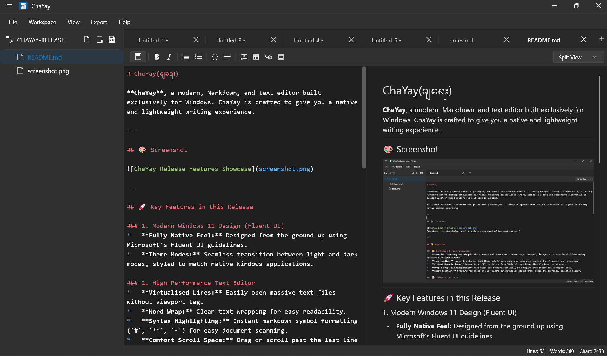

# ChaYay(ချရေး)

**ChaYay** is a lightweight, Markdown and text editor designed for Windows (and soon Linux). By utilizing Flutter's native desktop compilation and Microsoft's **Fluent Design System**, ChaYay stands as a fast and responsive alternative to bloated Electron-based editors.

---

## 🎨 Screenshot

---

## 📥 Downloads

Grab the latest preview executable for Windows from our [Releases](../../releases) section!

*   **Windows (x64):** Download the latest `.exe` or `.zip` artifact.

### System Requirements
*   Windows 10 or Windows 11 (64-bit)

## 🚀 Getting Started

1. Download the latest Windows release from the Releases page.
2. Extract the archive (if applicable) and launch `chayay.exe`.
3. Open a folder or use the Windows Explorer context menu to start writing!

## ⌨️ Accelerator Keys Cheatsheet

Use these global keyboard shortcuts to speed up your workflow:

| Shortcut | Action |
| :--- | :--- |
| **`Ctrl + N`** | Create a new unsaved tab |
| **`Ctrl + S`** | Save current tab |
| **`Ctrl + W`** | Close current tab |
| **`Ctrl + P`** | Export markdown to PDF |
| **`F2`** | Rename selected workspace file/folder |
| **`Delete`** | Delete selected workspace file/folder |
